<div align="center">


# Cursor 一键汉化

**把 Cursor 的菜单、设置、命令面板和 Agent 界面换成简体中文。点一下就能汉化，也能一键还原成英文原版。**

[](https://github.com/lidefang0918/cursor-zh/releases/latest)
[](https://github.com/lidefang0918/cursor-zh/releases)
[](LICENSE)
[](#-下载安装)
[](#支持哪些-cursor-版本)

[下载](#-下载安装) · [使用步骤](#-使用步骤) · [常见问题](#-常见问题) · [反馈](https://github.com/lidefang0918/cursor-zh/issues)

</div>

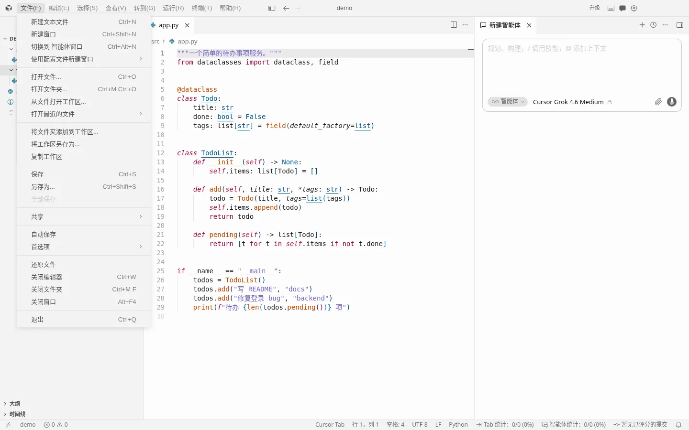

<p align="center">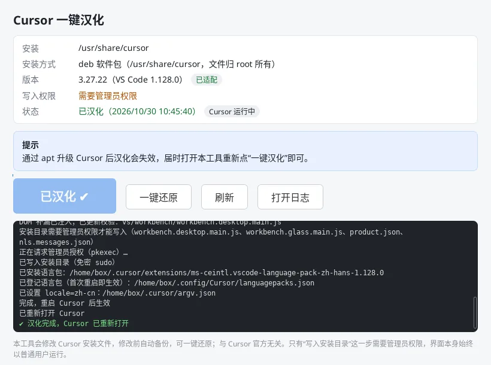</p>

## ✨ 特点

- **一键汉化，一键还原**：修改前自动备份原版文件。还原后与原版**逐字节相同**，签名也一并恢复。
- **只翻界面，不碰内容**：你的代码、文件名、AI 对话内容都不会被翻译。工具不读取、不修改你的登录信息、聊天记录和项目文件，也不收集、不上传任何数据。
- **品牌名和专有名词保留原文**：Cursor、Agent 里的模型名（Claude、GPT、Grok……）、Azure OpenAI、AWS Bedrock 等保持英文，不出现生硬的直译。
- **安装包只有几 MB**：界面使用系统自带的网页组件，不额外打包浏览器内核。
- **Cursor 升级后照样能用**：Cursor 自动更新后，工具会显示“汉化已失效”，重新点一下即可。就算是本工具还没专门适配的新版本，也能直接汉化（能翻的都翻，个别新文案暂时保持英文）。
- **词典自动更新**：每次汉化都会从 GitHub 取最新词典（国内访问慢时自动改用 jsDelivr 镜像），不用重新下载安装包；没网时用安装包自带的词典，照样能汉化。
- **三个平台都能用**：Windows 10/11、macOS（Apple 芯片和 Intel 通用）、Linux（deb、rpm、AppImage 安装的 Cursor 都支持）。

## 📊 功能覆盖

基于微软官方简体中文语言包（VS Code 的那部分界面），加上本项目的词典和补丁，覆盖 **Cursor 自己新增的界面**，也就是官方语言包翻不到的部分：

| 区域 | 内容 | 覆盖率 |
|---|---|---|
| 菜单栏 | 文件 / 编辑 / 选择 / 查看 / 转到 / 运行 / 终端 / 帮助，以及 Agents 窗口的菜单 | 100% |
| 右键菜单 | 资源管理器、编辑器、大纲、时间线 | 100% |
| 命令面板 | 759 条命令 | 99.9% |
| Cursor 设置 | 常规、套餐与用量、智能体、云端智能体、模型、语音、源代码管理、自定义、浏览器与网络、代码智能、测试版 | 99.8% |
| API 密钥区 | OpenAI、Anthropic、Google、Azure OpenAI、AWS Bedrock 的说明、按钮和输入框提示 | ✔ |
| Agent / Chat 面板 | 输入框提示、模式切换（智能体 / 规划 / 调试 / 多任务 / 问答）、模型选择、快捷提示 | ✔ |
| Agents 窗口 | 侧边栏、新建智能体、运行位置、仓库、环境、内置浏览器 | 97.5% |
| 下拉选项和展开区 | 设置里的所有下拉框、折叠区，以及聊天框的模式和模型下拉 | 95.8%–97.5% |
| **合计** | 在 Cursor 3.27.22 上自动扫描了 2664 条界面文字 | **98.5%** |

> 剩下的 1.5% 并不是漏翻，而是本来就该保留原文的内容，比如“Claude Opus 5.5 已启用”里的模型名、`例如 gpt-35-turbo` 这样的示例值。静态补丁替换 3078 处，模板片段 189 处，NLS 文案 1529 条，未命中 0 条。

<details>
<summary><b>📸 更多截图（点开查看）</b></summary>

**汉化前和汉化后对比（Cursor 设置 → 常规）**

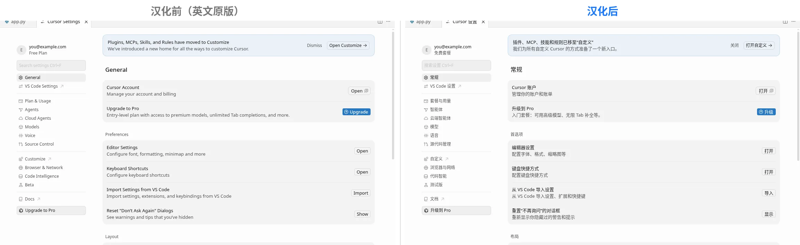

**命令面板**

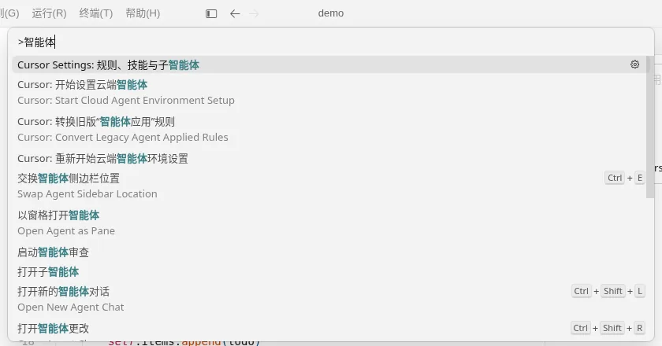

**Cursor 设置 → 智能体**

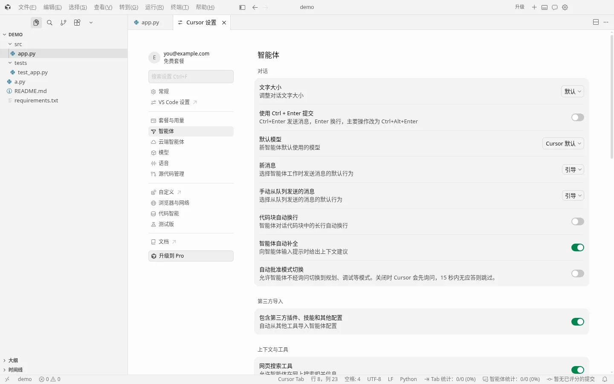

**Cursor 设置 → 模型**

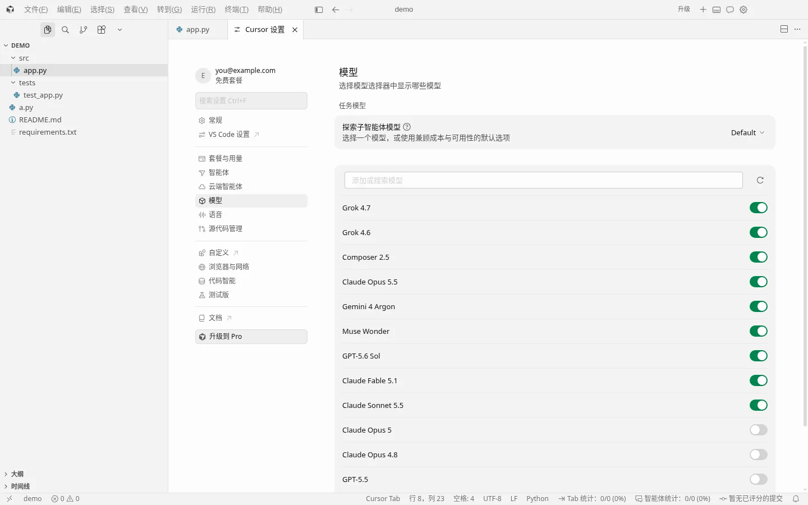

**模型 → API 密钥**

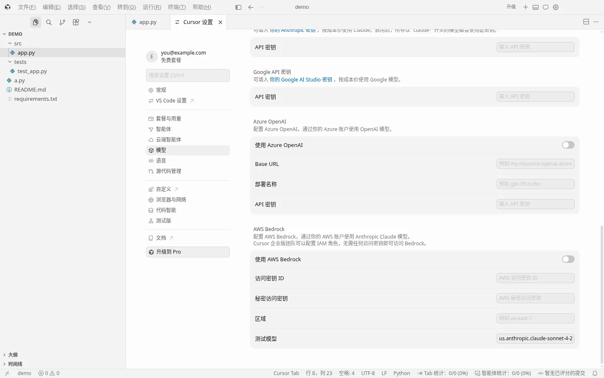

**Agent 面板：模式切换**

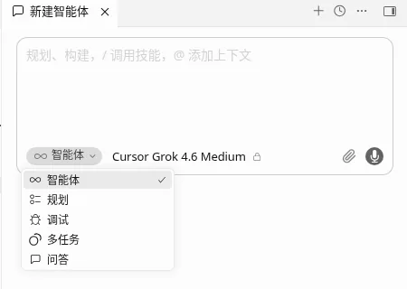

**右键菜单 / 查看菜单**

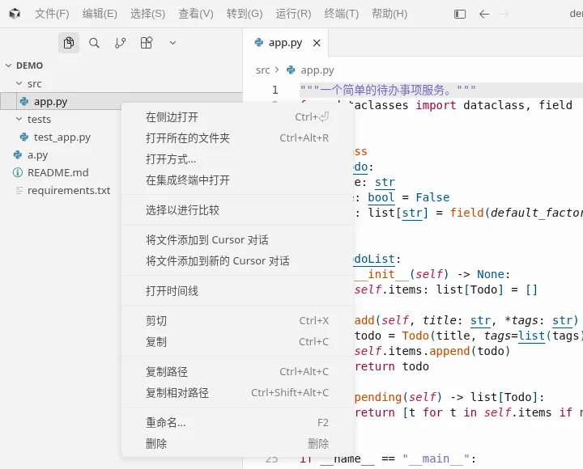 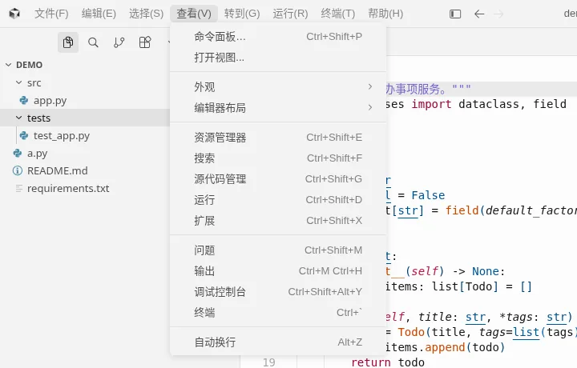

**Agents 窗口**

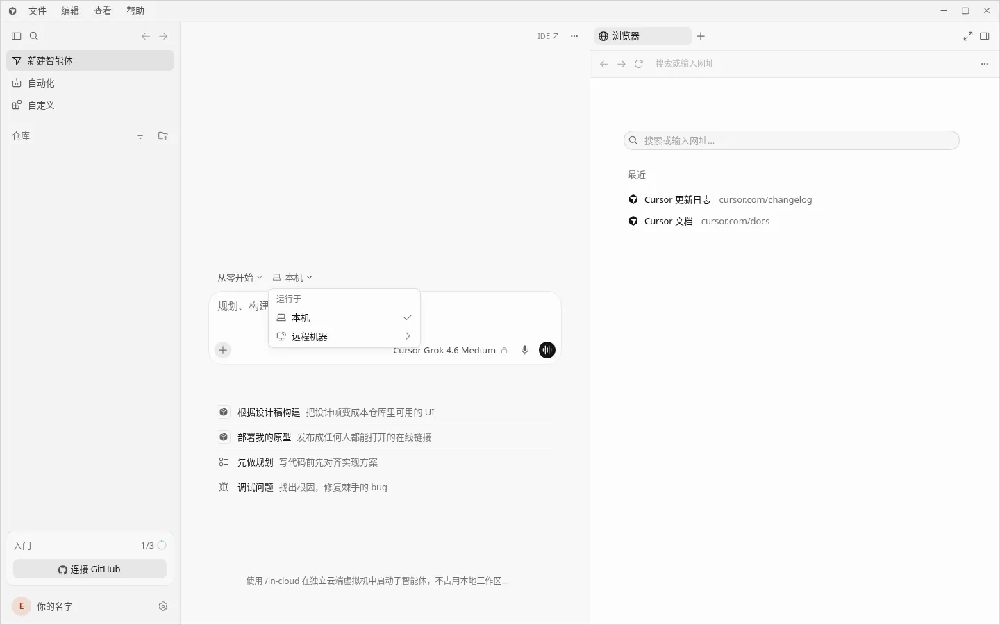

</details>

## 📥 下载安装

到 [Releases](https://github.com/lidefang0918/cursor-zh/releases/latest) 下载最新版，按你的系统选一个文件：

| 系统 | 下载 | 说明 |
|---|---|---|
| **Windows** 10/11 x64 | [安装版 setup.exe](https://github.com/lidefang0918/cursor-zh/releases/latest/download/cursor-zh-0.2.2-win-x64-setup.exe)（推荐，约 4 MB） | 安装后在开始菜单或桌面打开“Cursor 一键汉化” |
| | [免安装版 portable.exe](https://github.com/lidefang0918/cursor-zh/releases/latest/download/cursor-zh-0.2.2-win-x64-portable.exe) | 双击就能用 |
| | [命令行精简版 cli.zip](https://github.com/lidefang0918/cursor-zh/releases/latest/download/cursor-zh-0.2.2-win-x64-cli.zip)（不到 1 MB） | 解压后双击“一键汉化.bat” |
| **macOS** | [dmg 安装包](https://github.com/lidefang0918/cursor-zh/releases/latest/download/cursor-zh-0.2.2-mac-universal.dmg)（推荐） | Apple 芯片和 Intel 通用，拖进“应用程序”即可 |
| | [app.zip](https://github.com/lidefang0918/cursor-zh/releases/latest/download/cursor-zh-0.2.2-mac-universal.app.zip) | 解压后拖进“应用程序” |
| **Linux** x86_64 | [deb 安装包](https://github.com/lidefang0918/cursor-zh/releases/latest/download/cursor-zh-0.2.2-linux-amd64.deb) | `sudo apt install ./cursor-zh-0.2.2-linux-amd64.deb`，之后在应用菜单打开或运行 `cursor-zh` |
| | [AppImage](https://github.com/lidefang0918/cursor-zh/releases/latest/download/cursor-zh-0.2.2-linux-x86_64.AppImage) | `chmod +x` 后双击运行 |

想确认文件完整，可以用 [SHA256SUMS.txt](https://github.com/lidefang0918/cursor-zh/releases/latest/download/SHA256SUMS.txt) 核对。

### 首次打开的安全提示

本工具没有购买代码签名证书，系统第一次打开时会提醒。这是正常现象：

- **macOS**：如果提示“无法验证开发者”，在“应用程序”里**右键点击“Cursor 一键汉化” → 打开 → 打开**。macOS 15 及以上版本的做法是：先双击一次，然后到 **系统设置 → 隐私与安全性**，在页面底部点 **仍要打开**。

  也可以在终端执行下面这行，之后就能正常双击打开：

  ```bash
  xattr -dr com.apple.quarantine "/Applications/Cursor 一键汉化.app"
  ```

- **Windows**：如果弹出“Windows 已保护你的电脑”（SmartScreen），点 **更多信息 → 仍要运行**。

## 🚀 使用步骤

1. **打开“Cursor 一键汉化”**。窗口顶部会显示找到的 Cursor 安装位置、版本，以及是否已适配。
2. **点蓝色大按钮“一键汉化”**。如果 Cursor 正开着，工具会先征求你的同意再关闭它。未保存的内容 Cursor 会自动保留，完成后工具会自动重新打开 Cursor。

   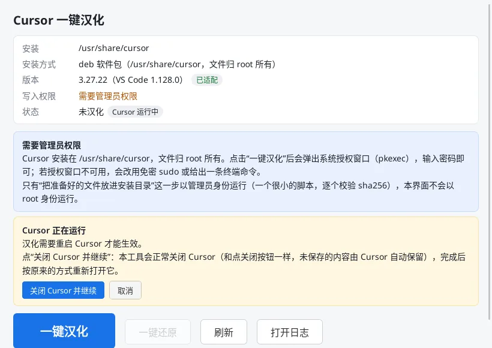

3. **看到“✔ 汉化完成”就好了**。如果个别地方还是英文，再重启一次 Cursor。

   

**想换回英文**：点 **一键还原**。还原后的文件与官方原版逐字节相同。

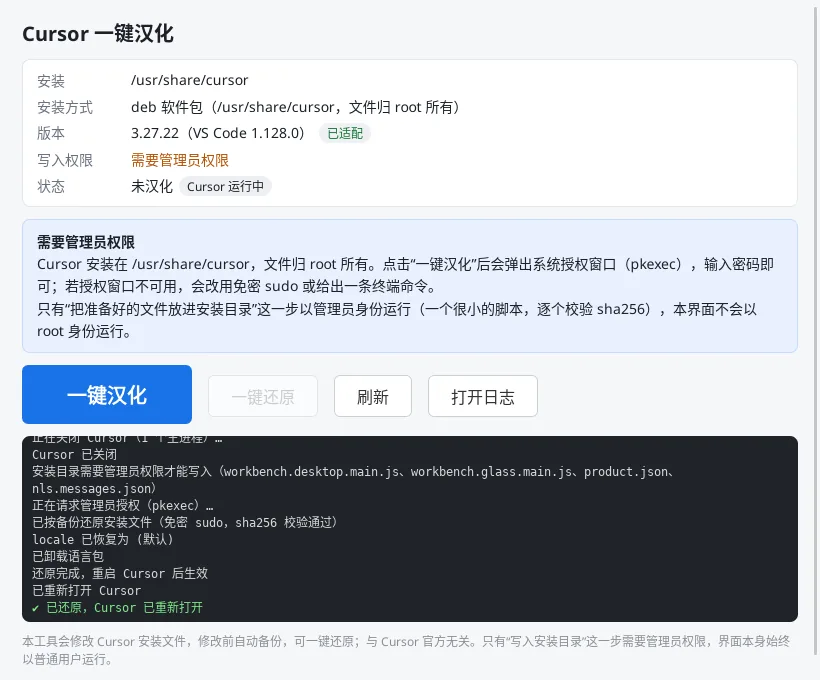

> **需要管理员权限的情况**：只有“把文件写进安装目录”这一步可能需要权限，工具本身始终以普通用户运行。
> - Windows 系统级安装（`C:\Program Files`）会弹出“用户账户控制”，点“是”。
> - Linux 的 deb/rpm 安装会弹出系统授权窗口，输入登录密码。
> - macOS 如果被“App 管理”拦截，到 **系统设置 → 隐私与安全性 → App 管理** 打开本工具的开关。

## ❓ 常见问题

### Cursor 更新后又变回英文了？

这是正常的，Cursor 更新时会覆盖汉化过的文件。打开本工具，按钮会显示“重新汉化”，点一下即可。

### Cursor 升级后还能用吗？

能。Cursor 升级到本工具还没专门适配的新版本时，窗口里会显示“兼容模式”，照常点“一键汉化”就行：工具会用最近一版的词典逐条匹配，能翻的都翻，匹配不上的少数地方保持英文，不会报错，也不会改坏 Cursor（不满意随时一键还原）。完成后会告诉你“已汉化多少条、多少条在此版本未匹配”。

词典放在 GitHub 上，每次汉化都会自动取最新的（取不到就用安装包自带的）。我们每天自动检查 Cursor 有没有出新版本，出了就尽快补上新文案；补好后你**不用重新下载本工具**，再点一次“一键汉化”（或“更新汉化”）就能补全。

> **macOS 用户**：汉化后 Cursor 自带的自动更新可能失败。建议**更新 Cursor 前先点“一键还原”**，更新完再汉化。

### 支持哪些 Cursor 版本？

目前专门适配过 **Cursor 3.27.14 和 3.27.22**（3.27.22 已在 Windows、macOS、Linux 真机上验证）。更新的版本也能用，见上一条。查看版本：Cursor 菜单 **帮助 → 关于**（Help → About）。

### 怎么完全还原？会不会把 Cursor 弄坏？

点 **一键还原** 即可。工具在第一次汉化前会把原版文件备份到下面“日志在哪里”表格中的目录里（`backups/<版本号>`），还原时逐个校验 sha256 后写回。还原后与官方原版逐字节相同，macOS 上的官方签名也会一起恢复。

想卸载本工具，请**先点一键还原，再卸载**。只卸载工具不会自动还原 Cursor。

### macOS 提示“Cursor 已损坏，无法打开”？

macOS 修改 App 内的文件后，原来的签名就失效了。工具在汉化后会自动重新签名（ad-hoc）并清除隔离标记，一般不会出现这个提示。如果还是出现了：

1. 先打开本工具点 **一键还原**，Cursor 会恢复为官方原版和官方签名；
2. 或者在终端执行 `xattr -dr com.apple.quarantine /Applications/Cursor.app` 后再打开；
3. 实在不行，从 [cursor.com](https://cursor.com) 重新下载安装 Cursor 即可，设置和聊天记录不受影响。

如果是**本工具自己**提示“已损坏”，请执行上文“首次打开的安全提示”里的 `xattr` 命令。

### macOS 弹出钥匙串“Cursor Safe Storage”提示？

汉化后 Cursor 用的是新签名，macOS 会询问是否允许它继续读取原来保存的登录凭据。请输入开机密码并选 **始终允许**，之后不会再问。如果点了“拒绝”，Cursor 可能需要重新登录。

### 日志在哪里？出错了怎么办？

失败时窗口会用中文写明原因和下一步建议。点 **打开日志** 可以直接打开日志文件 `gui.log`。日志、备份和状态都放在这里：

| 系统 | 位置 |
|---|---|
| Windows | `%APPDATA%\cursor-zh-localizer` |
| macOS | `~/Library/Application Support/cursor-zh-localizer` |
| Linux | `~/.config/cursor-zh-localizer` |

`backups` 目录里是汉化前的原版文件，“一键还原”要靠它，请不要删除。

### 汉化会影响 Cursor 的 AI 功能或者我的代码吗？

不会。工具只替换界面上显示的文字，除了把显示语言设为简体中文，不改变任何功能和设置。你写的代码、AI 的回答内容都保持原样。

## 💬 反馈

遇到问题、发现没翻译到的地方，或者觉得某个翻译不顺口，欢迎到 [Issues](https://github.com/lidefang0918/cursor-zh/issues) 反馈。请附上以下信息：

- 操作系统和 Cursor 版本（帮助 → 关于）
- 窗口截图
- `gui.log` 日志文件（位置见上文）

如果这个工具帮到了你，点个 ⭐ Star 支持一下吧。

## ⚠️ 免责声明

- 本项目是社区作品，**与 Cursor（Anysphere Inc.）官方无关**。“Cursor”是其所有者的商标。
- 本工具会**修改你电脑上 Cursor 的安装文件**（修改前自动备份，可一键还原）。请自行评估使用风险，作者不对因使用本工具造成的任何损失负责。

## 📄 许可证

本项目以 [MIT](LICENSE) 许可证开源。

发布的安装包里内置了微软的 [简体中文语言包](https://github.com/microsoft/vscode-loc)（MS-CEINTL.vscode-language-pack-zh-hans），它使用 MIT 许可证，版权归 Microsoft Corporation 所有，详见 [THIRD_PARTY_NOTICES.md](THIRD_PARTY_NOTICES.md)。

---

开发者文档（构建、架构、测试、新版本适配）：[docs/DEVELOPMENT.md](docs/DEVELOPMENT.md)
